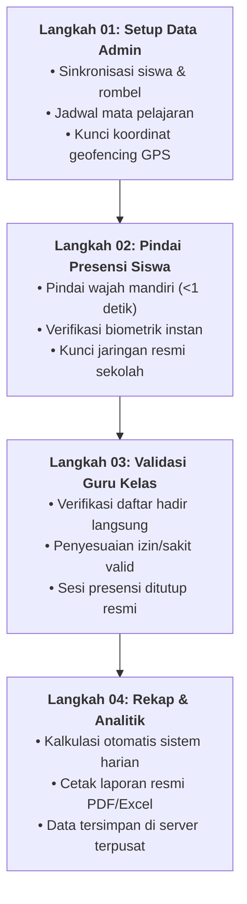

# 📊 DECK PRESENTASI: SISTEM PRESENSI SEKOLAH ONLINE
> **Target Audiens:** Kepala Dinas Pendidikan & Jajaran Pemangku Kebijakan Daerah  
> **Format File:** File PowerPoint (`.pptx`) 16:9 Widescreen Siap Pakai  
> **Tersedia di Server:** [Presentasi_Presensi_Sekolah_Dinas_Pendidikan.pptx](file:///www/wwwroot/presensi.tiksmkn1beringin.my.id/Presentasi_Presensi_Sekolah_Dinas_Pendidikan.pptx)  
> **Link Unduh Langsung Web:** `/downloads/Presentasi_Presensi_Sekolah_Dinas_Pendidikan.pptx`

---

## 🎨 Pedoman Desain & Palet Warna Presentasi
* **Dominan:** Midnight Navy (`#0F172A`) & Deep Royal Blue (`#1E3A8A`) — *Kesan formal, kredibel, dan kokoh*.
* **Aksen Keberhasilan & Nilai:** Emerald Green (`#10B981`) — *Melambangkan efisiensi, akurasi, dan penghematan*.
* **Aksen Peringatan & Urgensi:** Amber Gold (`#F59E0B`) & Coral Red (`#EF4444`) — *Melambangkan pain points dan peluang transformasi*.
* **Gaya Konten:** *Card Grid*, metrik angka besar, poin maksimal 5–7 kata (bebas paragraf padat).

---

## 📑 Struktur Slide & Naskah Presentasi (Speaker Notes)

```mermaid
flowchart LR
    S1["01. Judul & Visi"] --> S2["02. Masalah di Lapangan"]
    S2 --> S3["03. Solusi Ekosistem"]
    S3 --> S4["04. Dampak Strategis Dinas"]
    S4 --> S5["05. Alur Kerja 4 Langkah"]
    S5 --> S6["06. Pengalaman Siswa"]
    S6 --> S7["07. Efisiensi Guru"]
    S7 --> S8["08. Kendali Kepala Sekolah"]
    S8 --> S9["09. Keamanan & Efisiensi"]
    S9 --> S10["10. Roadmap & Pilot Project"]
```

---

### Slide 1: Judul Presentasi
* **Tema Visual:** Dark Executive Navy (`#0F172A`) dengan Card Kontras Tinggi.
* **Badge Atas:** `DIGITALISASI ADMINISTRASI PENDIDIKAN`
* **Judul Utama:** **Transformasi Digital Presensi Sekolah**
* **Sub-Judul:** *Mewujudkan Transparansi, Disiplin, dan Efisiensi Administrasi Pendidikan Berbasis Data Real-Time.*
* **Kartu Sorotan Utama:**
  | ⚡ Real-Time Monitoring | 🛡️ Validasi Biometrik | 📊 Rekapitulasi Otomatis |
  | :--- | :--- | :--- |
  | Terhubung langsung sekolah & dinas | Verifikasi presisi anti-titip absen | Ekspor laporan PDF & Excel instan |

> [!NOTE] **Naskah Berbicara (Speaker Notes):**  
> *"Selamat pagi/siang Bapak/Ibu Kepala Dinas dan jajaran pimpinan yang terhormat. Hari ini kami mempersembahkan sebuah inisiatif transformasi digital presensi sekolah terpadu. Sistem ini dirancang untuk menjawab tantangan tata kelola administrasi pendidikan daerah kita, menghadirkan transparansi dan kedisiplinan berbasis data nyata demi kemajuan generasi bangsa."*

---

### Slide 2: Masalah di Lapangan (Pain Points)
* **Tema Visual:** Light Gray Canvas dengan 3 Kartu Bergaris Aksen Merah/Kuning.
* **Badge Atas:** `EVALUASI KONDISI SAAT INI`
* **Judul Utama:** **3 Masalah Kritis Presensi Manual di Sekolah**
* **Sub-Judul:** *Tantangan administratif yang menghambat mutu pembelajaran dan pelaporan.*

| 🔴 45+ Jam/Bulan | 🟡 15–20% Deviasi | 🔵 7–14 Hari Delay |
| :--- | :--- | :--- |
| **Beban Rekapitulasi Manual Guru** | **Rawan Manipulasi & Data Palsu** | **Keterlambatan Pelaporan ke Dinas** |
| • Menghitung rekap absensi buku kertas • Menyita waktu persiapan mengajar • Rawan salah perhitungan persentase • Arsip fisik berantakan dan rapuh | • Praktik titip absen antar siswa • Tanda tangan mudah dipalsukan • Tidak ada validasi lokasi fisik siswa • Data kehadiran tidak valid | • Laporan bulanan bertumpuk di meja • Deteksi siswa rentan DO lambat • Sulit mengambil tindakan cepat • Format antar sekolah tidak seragam |

> [!NOTE] **Naskah Berbicara (Speaker Notes):**  
> *"Bapak Kepala Dinas, mari kita tinjau fakta lapangan hari ini. Guru kita kehilangan lebih dari 40 jam setiap bulan hanya untuk menjumlahkan centang di buku kertas absensi. Selain menyita waktu mengajar, data manual memiliki margin deviasi hingga 20% karena fenomena titip absen. Parahnya lagi, laporan kehadiran baru sampai di meja Dinas berminggu-minggu kemudian, sehingga intervensi terhadap siswa yang bermasalah seringkali sudah terlambat."*

---

### Slide 3: Solusi Kami (Overview Ekosistem)
* **Tema Visual:** 4 Kartu Pilar Terhubung (Siswa, Guru, Kepala Sekolah, Dinas).
* **Badge Atas:** `SOLUSI TERINTEGRASI`
* **Judul Utama:** **Ekosistem Presensi Sekolah Online Terpadu**
* **Sub-Judul:** *Platform cerdas menghubungkan 4 pemangku kepentingan dalam satu data tunggal.*

| 👤 SISWA | 👨‍🏫 GURU & WALI KELAS | 🏫 KEPALA SEKOLAH | 🏛️ DINAS PENDIDIKAN |
| :--- | :--- | :--- | :--- |
| • Presensi mandiri hitungan detik • Pengajuan izin/sakit digital • Pantau riwayat kehadiran transparan • Membangun disiplin sejak dini | • Pantau kehadiran kelas live • Bebas rekap buku manual • Notifikasi siswa alpa seketika • Fokus peningkatan mutu ajar | • Dashboard statistik sekolah • Pengawasan disiplin harian • Ekspor rekap PDF/Excel resmi • Keputusan berbasis bukti | • Monitoring serentak lintas sekolah • Deteksi dini anomali absensi • Standarisasi format satu data • Landasan kebijakan tepat sasaran |

> [!NOTE] **Naskah Berbicara (Speaker Notes):**  
> *"Solusi yang kami hadirkan bukan sekadar aplikasi absensi biasa, melainkan satu ekosistem terpadu. Dari siswa yang melakukan verifikasi mandiri, guru yang langsung melihat rekap di kelas, kepala sekolah yang memegang kendali mutu, hingga Dinas Pendidikan yang dapat memantau data kehadiran seluruh sekolah dalam satu layar tanpa perlu meminta laporan manual satu per satu."*

---

### Slide 4: Mengapa Penting bagi Dinas Pendidikan? (Strategic Impact)
* **Tema Visual:** 3 Kartu Nilai Strategis dengan Indikator Metrik Besar.
* **Badge Atas:** `NILAI STRATEGIS DINAS`
* **Judul Utama:** **Dampak Nyata bagi Pembuat Kebijakan**
* **Sub-Judul:** *Mendukung tata kelola pemerintahan digital (SPBE) sektor pendidikan.*

| 🟢 100% Terkoneksi | 🔵 95% Hemat Kertas | 🟡 1 Dashboard Presisi |
| :--- | :--- | :--- |
| **Monitoring Lintas Satuan Pendidikan** | **Efisiensi Logistik & Ramah Lingkungan** | **Data-Driven Decision Making** |
| • Pantau data kehadiran seluruh sekolah • Deteksi anomali absensi secara dini • Standardisasi laporan satu pintu • Hilangkan kesenjangan informasi lapangan | • Setop pembelian buku absensi kertas • Arsip digital aman tanpa resiko lapuk • Penghematan belanja ATK sekolah • Mendukung gerakan *Green School* | • Analisis tren disiplin berbasis fakta • Intervensi dini siswa rawan putus sekolah • Alokasi bantuan & pembinaan terarah • Akuntabilitas program daerah teruji |

> [!NOTE] **Naskah Berbicara (Speaker Notes):**  
> *"Bagi jajaran Dinas Pendidikan, platform ini adalah instrumen pengambil kebijakan (Decision Support System). Dengan 100% data real-time, Dinas bisa segera tahu jika ada tren penurunan kehadiran di suatu wilayah sebelum menjadi masalah besar. Program ini juga memangkas 95% biaya pengadaan kertas absensi fisik setiap tahunnya, mewujudkan birokrasi pendidikan yang bersih dan modern."*

---

### Slide 5: Alur Kerja Sistem (End-to-End Flow)
* **Tema Visual:** Diagram Alur 4 Langkah Mendatar (*Horizontal Stepper*).
* **Badge Atas:** `PROSES OPERASIONAL`
* **Judul Utama:** **4 Langkah Alur Kerja Sistem Presensi**
* **Sub-Judul:** *Proses otomatis dari awal jadwal belajar hingga laporan diterima Dinas.*

> [!NOTE] **Naskah Berbicara (Speaker Notes):**  
> *"Alur operasional kami rancang sangat sederhana agar mudah diadopsi. Langkah pertama, data siswa dan jadwal disinkronkan. Langkah kedua, siswa memindai wajah di kelas dalam hitungan milidetik. Langkah ketiga, guru cukup memvalidasi bila ada siswa sakit. Dan langkah keempat, seluruh rekapitulasi langsung terhitung otomatis dan siap dicetak sesuai format baku dinas."*

---

### Slide 6: Perspektif Siswa (Kemudahan & Kecepatan)
* **Tema Visual:** 3 Kartu Pengalaman Siswa (Speed & Simplicity).
* **Badge Atas:** `PENGALAMAN PENGGUNA: SISWA`
* **Judul Utama:** **Presensi Cepat, Disiplin Sejak Dini**
* **Sub-Judul:** *Aplikasi ramah gawai pintar siswa tanpa prosedur yang menyulitkan.*

| ⚡ < 1 Detik Scan | 📱 100% Digital Bebas Kertas | 📊 24/7 Monitoring Mandiri |
| :--- | :--- | :--- |
| **Presensi Wajah Mandiri** | **Pengajuan Izin & Sakit Online** | **Transparansi Riwayat Kehadiran** |
| • Arahkan kamera ke bingkai wajah • Otomatis memotret saat posisi pas • Tanpa gestur rumit melelahkan • Kompatibel smartphone siswa (BYOD) | • Unggah bukti surat dokter langsung • Pemberitahuan instan ke wali kelas • Kepastian status izin tanpa tercecer • Riwayat surat izin terdokumentasi rapi | • Siswa memantau persentase kehadiran • Menghindari resiko alpa tak sengaja • Membangun tanggung jawab mandiri • Informasi jam pelajaran selalu update |

> [!NOTE] **Naskah Berbicara (Speaker Notes):**  
> *"Dari sudut pandang anak didik, sistem ini sangat menyenangkan. Presensi selesai dalam sekejap tanpa antrean panjang. Bila siswa sakit, mereka tidak perlu menitip surat kertas yang rawan hilang; cukup foto surat dokter dan unggah langsung dari gawai orang tua. Siswa juga bisa memantau catatan persentase kehadirannya sendiri secara transparan."*

---

### Slide 7: Perspektif Guru & Wali Kelas (Efisiensi Mengajar)
* **Tema Visual:** 3 Kartu Produktivitas Guru.
* **Badge Atas:** `PENGALAMAN PENGGUNA: GURU`
* **Judul Utama:** **Bebas Administrasi, Fokus Mengajar**
* **Sub-Judul:** *Mengembalikan jam kerja guru untuk peningkatan kualitas pendidikan.*

| 🟢 0 Jam Rekap | 🔵 Live Monitoring Kelas | 🟡 100% Fokus Mengajar |
| :--- | :--- | :--- |
| **Bebas Rekapitulasi Manual** | **Pantauan Hadir & Alfa Seketika** | **Optimalisasi Waktu Kelas** |
| • Hilangkan stres menghitung absensi • Bebas resiko buku absen hilang/robek • Kalkulasi otomatis per semester • Hemat ratusan jam kerja pertahun | • Pantau siswa hadir/alfa per sesi • Verifikasi izin dengan 1 sentuhan • Notifikasi WhatsApp ke orang tua • Deteksi cepat siswa bolos pelajaran | • Waktu jam ajar utuh tanpa terpotong • Interaksi guru-murid lebih optimal • Evaluasi belajar lebih akurat • Kinerja guru meningkat signifikan |

> [!NOTE] **Naskah Berbicara (Speaker Notes):**  
> *"Inilah hadiah terbaik bagi para pendidik kita: 0 jam waktu terbuang untuk rekapitulasi buku absen. Guru tidak perlu lagi menghabiskan malam-malam sebelum pembagian rapor untuk menghitung hari hadir siswa. Waktu 15 menit di awal jam pelajaran yang biasanya habis untuk memanggil nama satu per satu, kini kembali menjadi waktu mengajar aktif."*

---

### Slide 8: Perspektif Admin & Kepala Sekolah (Kendali Penuh)
* **Tema Visual:** 3 Kartu Manajemen Eksekutif Sekolah.
* **Badge Atas:** `MANAJEMEN SEKOLAH`
* **Judul Utama:** **Kendali Penuh Manajemen & Mutu Disiplin**
* **Sub-Judul:** *Kepala sekolah memegang kendali kedisiplinan dan pelaporan secara presisi.*

| 📊 Statistik Eksekutif | ⚙️ Manajemen Jadwal & Rombel | 📄 1 Klik Ekspor Laporan |
| :--- | :--- | :--- |
| **Monitoring Terpadu Harian & Bulanan** | **Pengelolaan Terpusat Fleksibel** | **Laporan Resmi Siap Dinas** |
| • Grafik kehadiran per tingkat & jurusan • Peringkat kedisiplinan kelas terbaik • Deteksi pola absen hari tertentu • Akses instan dari HP kepala sekolah | • Sinkronisasi jadwal mapel terpadu • Pengaturan guru pengampu & piket • Kelola data siswa & mutasi kelas • Penyesuaian jam ujian/kegiatan khusus | • Unduh rekapitulasi format PDF & Excel • Format sesuai standar Dinas Pendidikan • Rekapitulasi per sesi & bulanan • Siap cetak sebagai laporan berkala |

> [!NOTE] **Naskah Berbicara (Speaker Notes):**  
> *"Bagi Kepala Sekolah, platform ini menyediakan dashboard eksekutif harian. Kepala sekolah tahu persis kelas mana yang paling disiplin, guru mana yang sudah hadir di kelas, dan tren kehadiran per jurusan. Ketika Dinas meminta rekap bulanan, cukup satu kali klik, dokumen PDF dan Excel berstandar resmi langsung tersaji rapi."*

---

### Slide 9: Keamanan, Keandalan & Kemudahan Implementasi
* **Tema Visual:** Grid 2x2 Kartu Infrastruktur & Tata Kelola.
* **Badge Atas:** `INFRASTRUKTUR TEKNOLOGI`
* **Judul Utama:** **Keamanan Solid & Kemudahan Penerapan**
* **Sub-Judul:** *Sistem dirancang handal, hemat biaya, dan tidak membebani anggaran sekolah.*

| 🌐 Akses Berbasis Web (Cloud-Ready) | 🛡️ Validasi Ganda & Anti-Kecurangan |
| :--- | :--- |
| • Dapat dibuka dari browser apa saja • Tanpa instalasi rumit Playstore/Appstore • Pembaruan sistem terpusat otomatis • Tidak memakan memori penyimpanan HP siswa | • Verifikasi biometrik ArcFace 512-dimensi • Validasi geofencing radius polygon GPS • Pengecekan jaringan resmi WiFi sekolah • Audit rekaman foto scan tersimpan aman |
| 📱 **Desain Intuitif (User-Friendly)** | 💰 **Efisiensi Anggaran Infrastruktur** |
| • Antarmuka bersih terinspirasi fintech modern • Sangat mudah digunakan guru senior • Mendukung mode gelap dan terang • Panduan visual jelas di setiap tahapan | • Tidak wajib beli mesin fingerprint mahal • Maksimalkan smartphone/tablet yang ada • Kebutuhan server sangat terjangkau • Siap integrasi kamera CCTV sekolah kelak |

> [!NOTE] **Naskah Berbicara (Speaker Notes):**  
> *"Seringkali program digitalisasi gagal karena perangkat mahal dan aplikasi yang rumit. Sistem kami berbasis web murni—dapat diakses langsung lewat Chrome tanpa perlu mengunduh aplikasi besar. Keamanannya diperkuat biometrik ArcFace dan geofencing radius GPS sekolah. Yang paling penting: sekolah tidak perlu membeli mesin absensi mahal jutaan rupiah."*

---

### Slide 10: Penutup & Rencana Implementasi (Call to Action)
* **Tema Visual:** Dark Navy Closing dengan 3 Tahap Roadmap & Kotak Komitmen.
* **Badge Atas:** `RENCANA STRATEGIS IMPLEMENTASI`
* **Judul Utama:** **Roadmap Penerapan & Uji Coba Lapangan**
* **Sub-Judul:** *Langkah nyata mewujudkan sekolah percontohan digital bersama Dinas Pendidikan.*

| 🟢 FASE 1 (Bulan ke-1) | 🔵 FASE 2 (Bulan ke-2) | 🟡 FASE 3 (Bulan ke-3) |
| :--- | :--- | :--- |
| **Pilot Project Percontohan** | **Pelatihan Guru & Operator** | **Evaluasi & Ekspansi Daerah** |
| • Penerapan di 1–2 sekolah percontohan • Verifikasi kesiapan data dan jaringan • Penyesuaian teknis operasional harian | • Workshop singkat 1 hari bagi operator • Panduan ringkas bagi wali kelas • Sosialisasi digital ke siswa & orang tua | • Paparan hasil efisiensi ke Kepala Dinas • Evaluasi kepuasan guru dan siswa • Perluasan bertahap ke sekolah daerah |

> #### 🤝 Komitmen Kolaborasi Bersama:
> *"Mewujudkan Tata Kelola Pendidikan yang Modern, Akuntabel, dan Berbasis Data Nyata Demi Kemajuan Generasi Bangsa."*  
> *Kami siap bermitra dan bersinergi dengan Dinas Pendidikan untuk memulai tahap percontohan (Pilot Project).*

> [!NOTE] **Naskah Berbicara (Speaker Notes):**  
> *"Sebagai penutup, kami mengusulkan langkah awal yang terukur: mari kita mulai dengan Pilot Project di satu atau dua sekolah percontohan selama satu bulan ke depan. Kami akan mendampingi penuh pelatihan operator dan guru. Setelah itu, kita bersama-sama mengevaluasi efisiensi nyata yang dihasilkan sebelum melangkah ke implementasi yang lebih luas. Terima kasih atas perhatian dan dukungan Bapak/Ibu sekalian."*

---

## 💡 Panduan Menghadapi Pertanyaan Kritis Kepala Dinas (Q&A Prep)

1. **"Bagaimana jika di sekolah ada siswa yang tidak memiliki HP?"**
   * *Jawaban*: Sistem mendukung mode **Kiosk Presensi / Tablet Sekolah** di pintu masuk atau gerbang. Siswa yang tidak membawa gawai cukup berdiri di depan tablet sekolah untuk verifikasi wajah otomatis.
2. **"Bagaimana dengan perlindungan data pribadi siswa (UU PDP)?"**
   * *Jawaban*: Sistem tidak menyimpan foto wajah mentah siswa untuk pencocokan, melainkan mengonversinya menjadi representasi vektor numerik 512 dimensi terenkripsi yang tidak dapat direkonstruksi kembali menjadi gambar wajah asli.
3. **"Berapa biaya pengadaan yang harus disiapkan Dinas?"**
   * *Jawaban*: Karena berbasis open-source dan memanfaatkan infrastruktur server sekolah/daerah yang sudah ada (seperti server Dual Xeon eksisting), biaya implementasi murni fokus pada pendampingan dan konfigurasi, menghemat hingga 70-80% dibanding membeli software komersial berlisensi tahunan per siswa.
