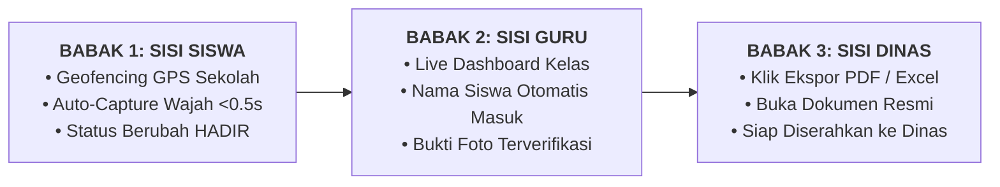

# 🎬 PLAYBOOK LIVE DEMO & PANDUAN PRESENTASI
### Di Hadapan Kepala Dinas Pendidikan & Pemangku Kebijakan Daerah

---

## 📋 1. Checklist Persiapan Teknis (15 Menit Sebelum Masuk Ruangan)

Sebelum proyektor dinyalakan di ruang Kepala Dinas, pastikan persiapan berikut:

* [ ] **Buka 2 Jendela / Tab Browser Bersih**:
  * **Tab 1 (Siswa/Kiosk):** Login akun siswa (misal di kelas `XI PPLG 3`), buka halaman `https://presensi.tiksmkn1beringin.my.id/siswa/dashboard`.
  * **Tab 2 (Guru/Admin):** Login akun Guru/Admin, buka halaman sesi aktif di `https://presensi.tiksmkn1beringin.my.id/dashboard/presensi`.
* [ ] **Pastikan Sesi Presensi Aktif Sudah Dibuat**: Buat 1 sesi kelas contoh untuk hari itu (misal: Mata Pelajaran *Koding & KA*, jam ke-1) dan pastikan siswa demo belum presensi (status masih kuning/`BELUM`).
* [ ] **Izin Kamera Aktif**: Pastikan browser Chrome sudah diberi izin akses webcam/kamera laptop.
* [ ] **File PDF/Excel Cadangan**: Siapkan 1 file unduhan PDF & Excel rekapitulasi presensi di desktop laptop (untuk jaga-jaga jika internet mendadak putus).
* [ ] **Mode Presentasi**: Jalankan slide PowerPoint di layar utama proyektor, siapkan tombol `Alt + Tab` untuk transisi mulus ke browser.

---

## ⏱️ 2. Kapan Waktu Paling Tepat untuk Pindah ke Live Demo?

> [!IMPORTANT] **Momen Transisi Terbaik:**
> Paling ideal melakukan Live Demo **tepat setelah Slide 5 (Alur Kerja Sistem)** atau **setelah Slide 8 (Perspektif Admin & Kepala Sekolah)**.
> 
> *Rekomendasi Terbaik:* Demo tepat setelah **Slide 5**, karena audiens baru saja melihat diagram 4 langkah alur kerja. Saat kamu bilang *"Biar tidak hanya teori, izinkan saya mendemokan langsung alur 4 langkah tadi secara real-time di aplikasi kami"*, perhatian Kepala Dinas akan 100% tersedot ke layar!

---

## 🎭 3. Skenario 3 Babak Live Demo (Total Waktu: 4–6 Menit)

---

### 🟢 BABAK 1: Pengalaman Siswa (The Instant Action) — Durasi: 1.5 Menit

**Langkah di Layar:**
1. Tekan `Alt + Tab` beralih dari Slide 5 ke **Tab Siswa** (`/siswa/dashboard`).
2. Tunjukkan kartu status presensi yang masih berwarna **kuning / BELUM**.
3. Sorot badge hijau: **"GPS Geofencing SMKN 1 Beringin: Terverifikasi Jaringan Sekolah"**.
4. Klik tombol biru besar: **"Mulai Verifikasi Wajah Face ID"**.
5. Hadapkan wajah ke kamera laptop/webcam. Dalam ~0.5 detik bingkai menyala hijau, terdengar bunyi *shutter* kamera, dan modal menutup.
6. Badge di layar seketika berganti menjadi **hijau terang: "HADIR"**.

> 🗣️ **Naskah Berbicara (Kata demi Kata):**
> *"Bapak Kepala Dinas, sekarang kita berada di layar gawai siswa. Perhatikan dua hal penting di sini:*
> *Pertama, siswa tidak bisa curang atau titip absen dari rumah, karena sistem otomatis mengunci radius GPS dan jaringan resmi sekolah. Di sini tertulis 'Terverifikasi Jaringan Sekolah'.*
> *Kedua, mari kita lihat betapa cepatnya proses presensi. Siswa cukup menekan 'Mulai Verifikasi Wajah'. (Klik tombol).*
> *Saya arahkan wajah saya ke bingkai oval... (Auto-capture jepret!).*
> *Selesai! Kurang dari satu detik, sistem AI ArcFace mencocokkan biometrik, dan status langsung berubah menjadi HADIR. Tidak ada antrean berdesakan, tidak ada kertas yang harus dioper."*

---

### 🔵 BABAK 2: Sisi Guru & Ruang Kelas (Live Monitoring) — Durasi: 1.5 Menit

**Langkah di Layar:**
1. Beralih ke **Tab Guru/Admin** (`/dashboard/presensi/{sesiPresensi}`).
2. Tunjukkan tabel daftar siswa kelas yang sedang berlangsung.
3. Sorot baris nama siswa demo yang baru saja melakukan scan: statusnya langsung tercatat **HADIR** lengkap dengan jam presensi tepat di detik tersebut.
4. Tunjukkan tombol *thumbnail* foto: guru bisa melihat foto asli wajah siswa saat scan dilakukan tadi.

> 🗣️ **Naskah Berbicara (Kata demi Kata):**
> *"Sekarang, kita lompat ke meja guru di ruang kelas yang sama.*
> *Guru tidak perlu lagi memegang pulpen dan memanggil absen 36 siswa satu per satu selama 15 menit.*
> *Secara real-time, nama siswa yang barusan saya pindai di HP tadi detik itu juga langsung muncul berstatus HADIR di dashboard guru lengkap dengan catatan jam dan foto verifikasinya.*
> *Bila ada siswa yang sakit atau izin, guru cukup memilih status siswa tersebut dengan satu klik. Waktu 15 menit yang biasanya habis untuk absen, kini 100% kembali menjadi jam belajar efektif."*

---

### 🟡 BABAK 3: Sisi Kepala Sekolah & Dinas (Instant Reporting) — Durasi: 1.5 Menit

**Langkah di Layar:**
1. Di halaman dashboard presensi guru/admin, arahkan kursor ke tombol hijau: **"Ekspor Excel"** atau tombol merah: **"Ekspor PDF"**.
2. Klik tombol **"Ekspor PDF"** (atau Excel harian).
3. Buka file PDF yang baru terunduh di layar proyektor.
4. Tunjukkan formatnya yang rapi, berlogo resmi, memuat rekapitulasi kehadiran lengkap, kolom persentase, dan tanda tangan Kepala Sekolah.

> 🗣️ **Naskah Berbicara (Kata demi Kata):**
> *"Lalu, apa manfaatnya bagi Kepala Sekolah dan Dinas Pendidikan?*
> *Biasanya, di akhir bulan staf tata usaha dan guru harus lembur berhari-hari merekap buku absen kertas untuk disetorkan ke Dinas Pendidikan.*
> *Di sistem ini, Kepala Sekolah atau admin cukup menekan satu tombol: 'Ekspor PDF'. (Klik unduh & buka PDF).*
> *Bim salabim! Dalam 1 detik, dokumen rekapitulasi kehadiran berstandar resmi langsung jadi. Sudah terformat rapi dengan persentase kehadiran per siswa, siap dicetak atau dikirimkan langsung sebagai tembusan berkala ke Dinas Pendidikan tanpa ada selisih angka."*

---

## ↩️ 4. Cara Kembali ke Slide PPT (The Climax & Closing)

Setelah PDF terbuka di layar:
1. Tekan `Alt + Tab` kembali ke **Slide 6** s/d **Slide 10**.
2. Lanjutkan paparan slide penutup dengan percaya diri.

> 🗣️ **Naskah Transisi Kembali ke Slide:**
> *"Bapak Kadis dan jajaran pimpinan yang terhormat, apa yang baru saja kita saksikan bersama adalah bukti bahwa digitalisasi pendidikan tidak harus mahal, tidak harus rumit, dan sudah siap berjalan hari ini.*
> *Mari kita kembali ke slide penutup untuk melihat bagaimana langkah konkret kita memulai uji coba percontohan di sekolah daerah kita."*

---

## 🛡️ 5. Rencana Cadangan (Live Demo Backup Plan)

Hukum Murphy dalam presentasi teknologi: *"Kalau ada yang bisa error saat demo, dia akan error"*. Jangan panik, siapkan mitigasi berikut:

| Potensi Kendala | Antisipasi / Respon Cepat di Panggung |
| :--- | :--- |
| **Koneksi Internet Ruang Rapat Lemot** | Jangan biarkan layar loading lama. Sampaikan: *"Karena koneksi internet gedung rapat sedang fluktuatif, izinkan saya membuka video demo operasional berdurasi 30 detik yang persis sama."* (Siapkan rekaman layar pendek di laptop). |
| **Pencahayaan Wajah Terlalu Gelap** | Jangan paksakan auto-capture. Langsung klik tombol manual: **"Ambil Foto Manual"** yang ada di bawah oval scanner! Tombol ini langsung memotret tanpa menunggu sensor stabil. |
| **Pertanyaan: "Kalau mati lampu/internet mati bagaimana?"** | *"Sistem kami memiliki mekanisme sinkronisasi data lokal. Siswa dan guru tetap bisa mencatat kehadiran secara offline sementara waktu di browser, dan begitu koneksi internet pulih, seluruh antrean data otomatis terunggah ke server tanpa data hilang."* |
| **Pertanyaan: "Berapa kapasitas server untuk ribuan siswa?"** | *"Arsitektur kami dibangun dengan framework enterprise berbasis Python FastAPI & Laravel dengan pemrosesan vektor 512-dimensi. Server sekolah kami saat ini sanggup memproses ribuan presensi serentak di bawah 1 detik tanpa lag."* |
